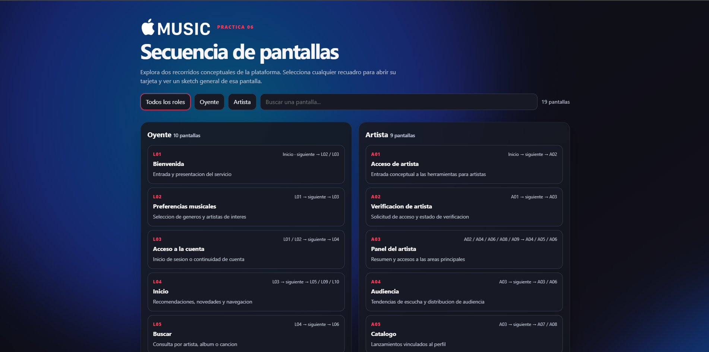

# Práctica 06: Secuencia de pantallas

Propuesta conceptual de experiencia móvil para Apple Music, con recorridos diferenciados para oyentes y artistas. El entregable incluye un diagrama interactivo, bocetos de interfaz y la definición de pantallas y transiciones.

## Vista previa

*Captura de la vista principal. Los diagramas visuales de pantallas aparecen al final de la página interactiva.*

## Objetivo

Organizar los puntos de entrada, decisiones y destinos de dos recorridos móviles mediante identificadores y transiciones. La práctica contempla 19 pantallas, por encima del mínimo de 15 solicitado.

## Aplicación y alcance

La aplicación seleccionada es **Apple Music**, la misma que se trabajó en la Práctica 03. Los flujos y wireframes de este proyecto son propuestas originales de diseño y no buscan reproducir con exactitud las pantallas oficiales.

El recorrido de artista representa una experiencia conceptual complementaria de **Apple Music for Artists**. No implica que la experiencia de gestión artística forme parte de la misma aplicación móvil de Apple Music.

## Roles y recorridos

### Oyente

Incluye 10 pantallas: bienvenida, preferencias musicales, acceso a la cuenta, inicio, búsqueda, resultados, detalle de álbum, reproductor, biblioteca y planes. El flujo permite descubrir y buscar música, reproducir contenido, guardar elementos y consultar opciones de suscripción.

### Artista

Incluye 9 pantallas: acceso, verificación, panel, audiencia, catálogo, estadísticas, detalle del lanzamiento, perfil y estado del lanzamiento. El recorrido conceptualiza la consulta de actividad y la gestión de presencia musical.

## Experiencia interactiva

- Filtra las pantallas por rol y busca por texto.
- Selecciona una pantalla para abrir su boceto móvil, objetivo y destinos siguientes.
- Recorre al final de la página las secuencias visuales de cada rol. Incluyen miniaturas de 8 pantallas por recorrido y flechas animadas.
- Cierra el modal con el botón o con `Esc`.
- En pantallas pequeñas, cada secuencia tiene desplazamiento horizontal independiente.
- El fondo y las flechas respetan la preferencia del sistema para reducir movimiento.

## Cómo abrirla

1. Abre [secuencia-pantallas.html](secuencia-pantallas.html) en un navegador.
2. También puedes abrir la carpeta `practica06` en Visual Studio Code y ejecutar el archivo con Live Server.

No requiere instalación, dependencias ni conexión a un servidor de datos. El logo se carga desde `../practica03/apple-music-transparent-v2.png`, por lo que conviene conservar la estructura de carpetas del proyecto.

## Archivos

| Archivo | Descripción |
| --- | --- |
| [secuencia-pantallas.html](secuencia-pantallas.html) | Interfaz interactiva, filtros, búsqueda, modales, wireframes y secuencias visuales. |
| [secuencia-pantallas.json](secuencia-pantallas.json) | Datos estructurados de los roles, las pantallas y sus destinos. |
| [prompt.md](prompt.md) | Instrucciones y criterios usados para definir el entregable. |
| `image.png` | Captura de evidencia de la vista principal. |
| `../practica03/apple-music-transparent-v2.png` | Logo reutilizado en el encabezado y los bocetos. |

## Modelo de datos

Cada pantalla del JSON contiene un identificador único, el rol asociado, título, objetivo, descripción y una lista de destinos. Los prefijos `L` y `A` identifican respectivamente las pantallas de Oyente y Artista.

## Evidencia

La captura incluida muestra la página principal con el logotipo, los filtros y los primeros elementos de ambos recorridos. La secuencia visual completa se puede revisar al final del archivo HTML.
